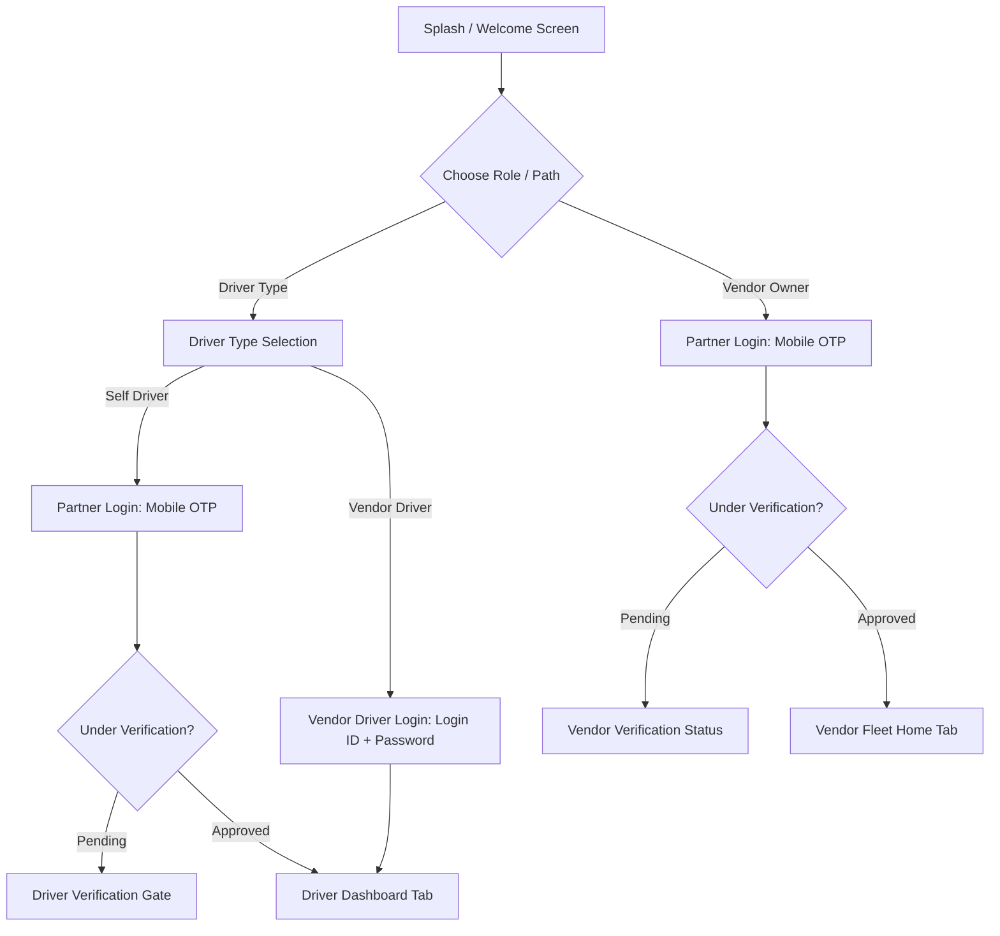

# RACE Partner Mobile Application — End-to-End User Journeys & Flow Map

> **Generated:** October 2026
> **Scope:** Self Driver, Vendor / Fleet Owner, and Vendor Driver operational journeys.

---

## 1. Journey Overview by Persona



---

## 2. Journey 1: Self Driver (Independent Operator)

### Phase 2.1 — Authentication & Verification
1. **Entry:** User launches app and selects **Driver** from Welcome screen.
2. **Subtype Selection:** User selects **Self Driver** on `DriverTypeSelectScreen`.
3. **Authentication:**
   - Enters 10-digit mobile number on `PartnerLoginScreen`.
   - Receives and submits 6-digit SMS OTP.
   - Profile status is queried from `GET /api/v1/profile`.
4. **Verification Gate:**
   - If `driverProfile.status !== 'APPROVED'`, user lands on `DriverVerificationGateScreen`.
   - Interactive step tracker shows: *Profile Submitted* -> *Documents Under Review* -> *Final Approval*.
   - Read-only preview allows viewing dashboard, but operational job actions and availability toggle are blocked.
   - When status becomes `APPROVED`, full access is unlocked.

### Phase 2.2 — Availability & Job Discovery
1. **Dashboard:**
   - Driver lands on `DriverDashboardScreen`.
   - Top bar displays online/offline toggle, GPS status indicator, and notification bell (`openPartnerNotifications`).
   - Driver turns toggle **Online** (`PUT /api/v1/driver/availability` with `{ isAvailable: true }`).
   - Location reporting hook (`useDriverLocationReporting`) broadcasts background coordinates.
2. **Incoming Request:**
   - Audio/visual incoming job modal pops over the screen.
   - Displays pickup distance, service type (Towing / Driver), vehicle category, and estimated earnings.
   - Actions: **Accept** or **Decline**.

### Phase 2.3 — 4-Step Trip Lifecycle
```
[Available Request]
        │
        ▼ (Accept)
[Accepted / Assigned] ──> Navigate to pickup with live route overview
        │
        ▼ (Mark Arrived)
[Arrived at Pickup] ────> Customer contact option & inspection
        │
        ▼ (Verify 4-Digit Trip OTP)
[Trip In Progress] ─────> En route to dropoff / service execution
        │
        ▼ (Complete Service)
[Completed Trip] ───────> Confirmed Fare breakdown & Earnings summary
```

1. **En Route to Pickup:** Driver presses **Start Navigation** or **Arrived**.
2. **Customer Trip OTP Verification:**
   - Driver prompts customer for the 4-digit verification OTP provided in the Customer app.
   - Submits OTP to `POST /api/v1/driver/jobs/:id/verify-otp`.
   - Invalid OTP stops progress with error feedback; correct OTP transitions state to `IN_PROGRESS`.
3. **Trip Completion:**
   - Driver marks trip complete.
   - Summary card displays gross fare, platform cut, net earnings, and updates today's KPI tally.

### Phase 2.4 — Account & Management
- Driver navigates to **Account Tab** (`PartnerAccountScreen`):
  - **Edit Profile:** Avatar photo upload, address, languages.
  - **Vehicle Info:** Tow truck photos, plate number, insurance expiry.
  - **Documents:** 6 required documents (Aadhaar, DL, RC, Commercial Permit, Fitness, Police Verification).
  - **Earnings & Payouts:** Weekly earnings chart, breakdown by trip, payout history.
  - **Bank Details:** Verified bank account with IFSC for automated settlements.
  - **Notifications:** Inbox grouped by Today/Yesterday with category filters.

---

## 3. Journey 2: Vendor / Fleet Owner (Business Operator)

### Phase 3.1 — Authentication & Business Verification
1. **Entry:** User selects **Vendor / Fleet Owner** on Welcome screen.
2. **Authentication:**
   - Mobile number + OTP verification on `PartnerLoginScreen`.
   - Auth store sets role to `vendor`.
3. **Business Verification:**
   - Verification status verified via `GET /api/v1/vendor/status`.
   - Pending vendors view review stages: *Submitted* -> *Document Review* -> *Background Check* -> *Approved*.

### Phase 3.2 — Fleet Operations & Dispatching
1. **Vendor Home:**
   - Displays real-time business KPIs: **Incoming Leads**, **Active Drivers** (On Job vs Available), **Fleet Vehicles** (Active vs Maintenance), and **Weekly Earnings**.
   - **Incoming Leads Banner:** Highlights unassigned booking requests.
   - Notification bell in header opens `PartnerNotificationsScreen`.
2. **Lead Triage & Assignment:**
   - Vendor taps **"Assign Vehicle & Driver"** directly on the lead card (or opens **Jobs Tab** -> `PartnerJobsScreen`).
   - Deep-links to `VendorAssignJobScreen` with pre-filled booking ID, type, pickup address, and estimated fare.
   - Screen renders available fleet vehicles with vehicle artwork, plate number, and type.
   - Vendor selects vehicle and confirms assignment (`POST /api/v1/vendor/bookings/:id/approve`).
   - Booking transitions to assigned state; dispatched to driver.

### Phase 3.3 — Fleet & Workforce Management
1. **Vendor Drivers (`VendorDriversScreen`):**
   - Search by name, phone, or license plate.
   - Filter by Active, On Job, Inactive.
   - **Add Driver Modal:** Vendor provisions Login ID and password for employed driver, inputs phone, name, license number, and uploads Aadhaar/DL documents.
2. **Vendor Vehicles (`VendorVehiclesScreen`):**
   - Search by registration plate, vehicle type, or model.
   - View maintenance warnings and insurance expiration indicators.
   - **Add Vehicle Modal:** Vendor registers new tow truck or assistance vehicle with RC and permit details.
3. **Bank & Payouts:**
   - Vendor accesses `PartnerBankDetailsScreen` to configure the enterprise settlement account.

---

## 4. Journey 3: Vendor Driver (Employed Operator)

### Phase 4.1 — Authentication
1. **Entry:** Driver selects **Driver** -> **Vendor Driver** on `DriverTypeSelectScreen`.
2. **Credentials Login:**
   - Authenticates via `VendorDriverLoginScreen` using the vendor-provided Login ID and password.
   - Mutation calls `POST /api/v1/auth/vendor-driver-login`.
   - Auth store records `role: 'driver'` and `driverSubtype: 'vendor_driver'`.

### Phase 4.2 — Operational Execution & Permission Boundary
1. **Routing:**
   - Sent directly to `DriverDashboardScreen` and `DriverJobsScreen`.
   - Displays assigned trips filtered for that specific driver.
   - Executes standard 4-step trip cycle with customer trip OTP verification.
2. **Access Security Guard:**
   - Cannot access `VendorDriversScreen`, `VendorVehiclesScreen`, or Vendor dispatch queues.
   - Attempts to access vendor management routes are blocked by role guard.
